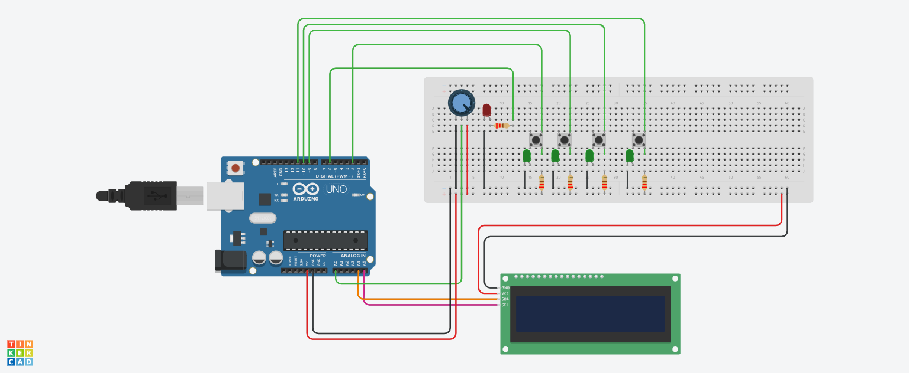

# TOS-game-IOT 

A fast-paced reaction game for Arduino where players must replicate a 4-digit LED sequence using buttons against a dynamic, shrinking timer.

## Table of Contents 

- [About the Project](#about-the-project)
- [Features](#features-star)
- [Tech Stack](#tech-stack-computer)
- [Installation](#installation-wrench)
- [How to Use](#how-to-use-play)
- [Project Structure](#project-structure-file-folder)

## About the Project 

"Turn on the Sequence!" (TOS) is an engaging Arduino-based reaction game designed for quick, fun gameplay. Players are presented with a 4-digit sequence displayed on an LCD screen and must quickly input the same sequence using four distinct buttons. The challenge escalates with a dynamically shrinking timer, adding a layer of urgency to each round. This project is implemented using procedural C/C++ with the Arduino Wiring framework, employing a super-loop architecture for its core logic.

## Features 

- **Sequence Replication:** Players must accurately replicate a 4-digit sequence.
- **Dynamic Timer:** A shrinking timer adds pressure to gameplay, with time limits decreasing as the score increases.
- **Difficulty Levels:** Adjustable difficulty settings influence the timer speed.
- **Visual Feedback:** Utilizes an LCD for displaying sequences, scores, and game status.
- **LED Indicator:** An LED provides visual feedback, potentially pulsing or indicating game over.
- **Button Input:** Four buttons for player input, with debouncing for reliable detection.
- **Super-Loop Architecture:** A common pattern in embedded systems for managing game states and loops.

## Tech Stack 

- **Language:** C/C++ (Arduino Wiring framework)
- **Hardware:** Arduino (implied by Wiring framework and typical IOT/game projects)
- **Libraries:** `LiquidCrystal_I2C` (for LCD control), standard Arduino libraries.

## Installation 

To set up and run this project, you will need:

1.  **Arduino IDE:** Download and install the latest version of the Arduino IDE from the [official Arduino website](https://www.arduino.cc/en/software).
2.  **Hardware:** An Arduino board (e.g., Arduino Uno, Nano) and associated components:
    *   LCD Display (compatible with `LiquidCrystal_I2C` and I2C address `0x27`)
    *   4 Push Buttons
    *   LED
    *   Potentiometer (for difficulty adjustment)
    *   Wiring and power supply for the Arduino and components.
3.  **Libraries:** Ensure you have the `LiquidCrystal_I2C` library installed in your Arduino IDE. You can typically install libraries via the Library Manager (`Sketch > Include Library > Manage Libraries...`). Search for `LiquidCrystal_I2C` and install a compatible version.

**Steps:**

1.  **Clone the Repository:**
    ```bash
    git clone https://github.com/steppo04/TOS-game-IOT.git
    cd TOS-game-IOT
    ```
2.  **Connect Hardware:** Wire your Arduino board, LCD, buttons, LED, and potentiometer according to the project's requirements. Refer to the pin definitions in `src/assign01/config.h`, `src/assign01/input.cpp`, and `src/assign01/output.cpp` for specific pin assignments (e.g., `BTN_B1`, `LED_LS`, `POT_PIN`).
   
4.  **Upload the Code:**
    *   Open the `src/assign01/assign01.ino` file in the Arduino IDE.
    *   Select the correct board and port from the `Tools` menu.
    *   Upload the sketch to your Arduino board.

## How to Use 

This game is designed for interactive play on an Arduino.

1.  **Start the Game:** Upon uploading the code and powering the Arduino, the LCD will display a welcome message: "Welcome to TOS!! Press B1 to start...". Press the button connected to `BTN_B1` to begin.
2.  **Gameplay:**
    *   The game will first show a welcome message and then display a 4-digit sequence (numbers 1-4).
    *   You must press the corresponding buttons (`BTN_B1` to `BTN_B4`) in the correct order to match the displayed sequence.
    *   Each successful sequence match increments your score and makes the next round slightly faster (by reducing `timeLimit` based on the `F` factor).
    *   The game continues with increasingly shorter time limits as your score increases.
3.  **Difficulty:** The difficulty can be adjusted using the potentiometer connected to `POT_PIN`. The `readDifficulty()` function maps the analog reading to difficulty levels 1, 2, or 3.
4.  **Game Over:** If you fail to enter the sequence correctly within the time limit or press the wrong button, the game ends. The LED connected to `LED_LS` will light up, and "Game Over" with your final score will be displayed on the LCD.

## Project Structure 📁

```
TOS-game-IOT/
├── doc/
│   └── LINK_TO_VIDEO.txt
├── src/
│   └── assign01/
│       ├── assign01.ino
│       ├── config.h
│       ├── game.cpp
│       ├── game.h
│       ├── input.cpp
│       ├── input.h
│       ├── output.cpp
│       └── output.h
└── README.md
```

- **`doc/`**: Contains supplementary documentation, like video links.
- **`src/assign01/`**: Houses the main source code for the game.
  - `assign01.ino`: The main Arduino sketch file.
  - `config.h`: Configuration settings for the game.
  - `game.cpp` / `game.h`: Game logic, sequence generation, scoring, and round management.
  - `input.cpp` / `input.h`: Handles button reading, debouncing, and difficulty input.
  - `output.cpp` / `output.h`: Manages LCD display output and LED control.
- **`README.md`**: The project's main documentation file.

## License 📄

This project is licensed under the MIT License - see the [LICENSE](LICENSE) file for details.


[](https://github.com/steppo04/TOS-game-IOT/stargazers)
[](https://github.com/steppo04/TOS-game-IOT/fork)

---

---
